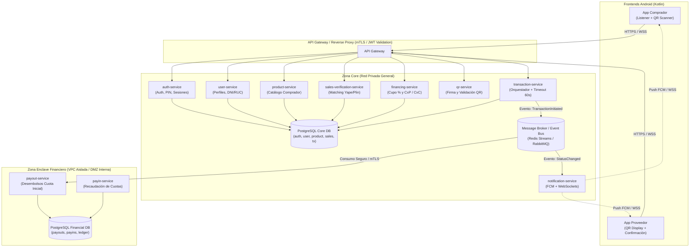
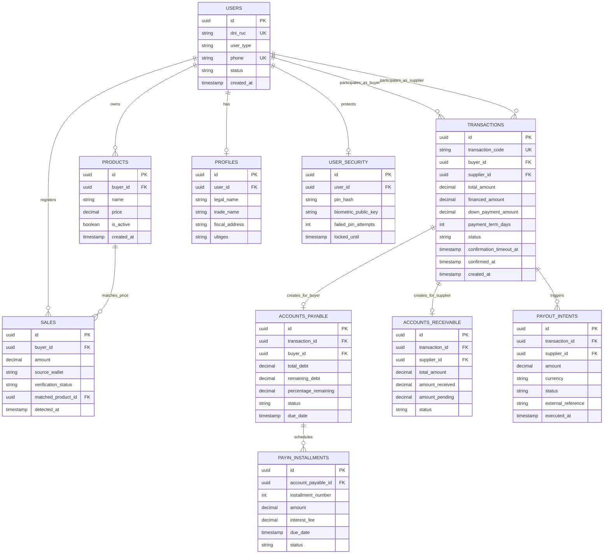
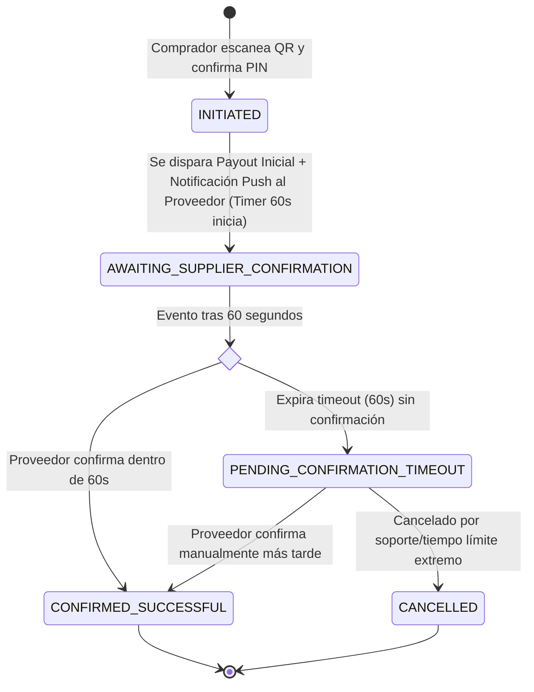

# Especificación Técnica de Arquitectura, Modelos de Datos (DB) y Contratos API — Kuota v1.0 (MVP)

Esta especificación formaliza la arquitectura técnica, los esquemas de bases de datos relacionales (PostgreSQL) y los contratos de API REST/OpenAPI para la plataforma **Kuota**, con base en el PRD v1.0.

---

## 1. Arquitectura de Servicios y Zonas de Aislamiento

Para dar cumplimiento a los requerimientos no funcionales de seguridad (**Sección 8.1 del PRD**), el backend se divide en dos zonas lógicas y de red:

1. **Zona de Dominio General (Core Services):** Servicios de interacción con usuarios, catálogo, lectura de notificaciones, cálculo de cupo y orquestación transaccional.
2. **Zona Enclave Financiero (Isolated High-Security Zone):** Servicios que interactúan con dinero real (desembolsos a proveedores y recaudación de cuotas a compradores). Cuentan con credenciales bancarias/API keys cifradas en KMS, red privada sin acceso público directo y base de datos con cifrado a nivel de columna (pgcrypto/TDE).



---

## 2. Modelo Entidad-Relación (ERD)



---

## 3. Esquemas de Base de Datos (PostgreSQL DDL)

### 3.1 Esquema Core (`kuota_core`)

```sql
CREATE SCHEMA IF NOT EXISTS kuota_core;

CREATE TYPE kuota_core.user_role AS ENUM ('BUYER', 'SUPPLIER', 'ADMIN');
CREATE TYPE kuota_core.user_status AS ENUM ('PENDING_VERIFICATION', 'ACTIVE', 'BLOCKED');
CREATE TYPE kuota_core.sale_status AS ENUM ('COMPROBADA', 'NO_COMPROBADA');
CREATE TYPE kuota_core.tx_status AS ENUM (
    'INITIATED',
    'AWAITING_SUPPLIER_CONFIRMATION',
    'CONFIRMED_SUCCESSFUL',
    'PENDING_CONFIRMATION_TIMEOUT',
    'CANCELLED'
);

-- Tabla de Usuarios Principales
CREATE TABLE kuota_core.users (
    id UUID PRIMARY KEY DEFAULT gen_random_uuid(),
    dni_ruc VARCHAR(20) NOT NULL UNIQUE,
    role kuota_core.user_role NOT NULL,
    phone VARCHAR(20) NOT NULL UNIQUE,
    status kuota_core.user_status NOT NULL DEFAULT 'ACTIVE',
    created_at TIMESTAMPTZ NOT NULL DEFAULT NOW(),
    updated_at TIMESTAMPTZ NOT NULL DEFAULT NOW()
);

-- Perfiles de Usuario
CREATE TABLE kuota_core.profiles (
    id UUID PRIMARY KEY DEFAULT gen_random_uuid(),
    user_id UUID NOT NULL REFERENCES kuota_core.users(id) ON DELETE CASCADE,
    legal_name VARCHAR(255) NOT NULL,
    address TEXT NOT NULL,
    metadata JSONB DEFAULT '{}'::jsonb,
    created_at TIMESTAMPTZ NOT NULL DEFAULT NOW(),
    CONSTRAINT uq_profiles_user UNIQUE (user_id)
);

-- Seguridad: Hash de PIN y Biometría
CREATE TABLE kuota_core.user_security (
    id UUID PRIMARY KEY DEFAULT gen_random_uuid(),
    user_id UUID NOT NULL REFERENCES kuota_core.users(id) ON DELETE CASCADE,
    pin_hash VARCHAR(255) NOT NULL, -- Argon2id o BCrypt salt
    biometric_public_key TEXT,
    failed_attempts INT NOT NULL DEFAULT 0,
    locked_until TIMESTAMPTZ,
    updated_at TIMESTAMPTZ NOT NULL DEFAULT NOW(),
    CONSTRAINT uq_security_user UNIQUE (user_id)
);

-- Catálogo de Productos (Comprador)
CREATE TABLE kuota_core.products (
    id UUID PRIMARY KEY DEFAULT gen_random_uuid(),
    buyer_id UUID NOT NULL REFERENCES kuota_core.users(id) ON DELETE CASCADE,
    name VARCHAR(150) NOT NULL,
    price NUMERIC(12, 2) NOT NULL CHECK (price > 0),
    is_active BOOLEAN NOT NULL DEFAULT TRUE,
    created_at TIMESTAMPTZ NOT NULL DEFAULT NOW(),
    updated_at TIMESTAMPTZ NOT NULL DEFAULT NOW()
);

CREATE INDEX idx_products_buyer_active ON kuota_core.products (buyer_id, is_active);
CREATE INDEX idx_products_buyer_price ON kuota_core.products (buyer_id, price) WHERE is_active = TRUE;

-- Registro de Ventas Interceptadas por Listener
CREATE TABLE kuota_core.sales (
    id UUID PRIMARY KEY DEFAULT gen_random_uuid(),
    buyer_id UUID NOT NULL REFERENCES kuota_core.users(id) ON DELETE CASCADE,
    amount NUMERIC(12, 2) NOT NULL CHECK (amount > 0),
    source_app VARCHAR(50) NOT NULL, -- Ej: 'YAPE', 'PLIN'
    status kuota_core.sale_status NOT NULL,
    matched_product_id UUID REFERENCES kuota_core.products(id) ON DELETE SET NULL,
    raw_payload_checksum VARCHAR(64), -- Deduplicación de notificaciones
    detected_at TIMESTAMPTZ NOT NULL,
    created_at TIMESTAMPTZ NOT NULL DEFAULT NOW()
);

CREATE INDEX idx_sales_buyer_status ON kuota_core.sales (buyer_id, status);
CREATE INDEX idx_sales_buyer_detected ON kuota_core.sales (buyer_id, detected_at DESC);

-- Transacciones de Financiamiento
CREATE TABLE kuota_core.transactions (
    id UUID PRIMARY KEY DEFAULT gen_random_uuid(),
    transaction_code VARCHAR(32) NOT NULL UNIQUE,
    buyer_id UUID NOT NULL REFERENCES kuota_core.users(id),
    supplier_id UUID NOT NULL REFERENCES kuota_core.users(id),
    total_amount NUMERIC(12, 2) NOT NULL CHECK (total_amount > 0),
    down_payment_amount NUMERIC(12, 2) NOT NULL CHECK (down_payment_amount >= 0),
    financed_amount NUMERIC(12, 2) NOT NULL CHECK (financed_amount > 0),
    payment_term_days INT NOT NULL CHECK (payment_term_days > 0),
    status kuota_core.tx_status NOT NULL DEFAULT 'INITIATED',
    confirmation_timeout_at TIMESTAMPTZ NOT NULL,
    confirmed_at TIMESTAMPTZ,
    rejection_reason TEXT,
    created_at TIMESTAMPTZ NOT NULL DEFAULT NOW(),
    updated_at TIMESTAMPTZ NOT NULL DEFAULT NOW(),
    CONSTRAINT chk_amounts CHECK (total_amount = down_payment_amount + financed_amount)
);

CREATE INDEX idx_tx_buyer ON kuota_core.transactions (buyer_id, status);
CREATE INDEX idx_tx_supplier ON kuota_core.transactions (supplier_id, status);
CREATE INDEX idx_tx_timeout ON kuota_core.transactions (status, confirmation_timeout_at) 
    WHERE status = 'AWAITING_SUPPLIER_CONFIRMATION';

-- Cuentas por Pagar (Comprador)
CREATE TABLE kuota_core.accounts_payable (
    id UUID PRIMARY KEY DEFAULT gen_random_uuid(),
    transaction_id UUID NOT NULL REFERENCES kuota_core.transactions(id) ON DELETE RESTRICT,
    buyer_id UUID NOT NULL REFERENCES kuota_core.users(id),
    total_financed NUMERIC(12, 2) NOT NULL,
    remaining_balance NUMERIC(12, 2) NOT NULL,
    percentage_remaining NUMERIC(5, 2) GENERATED ALWAYS AS (
        CASE WHEN total_financed = 0 THEN 0 ELSE ROUND((remaining_balance / total_financed) * 100, 2) END
    ) STORED,
    status VARCHAR(30) NOT NULL DEFAULT 'ACTIVE', -- ACTIVE, PAID, OVERDUE
    created_at TIMESTAMPTZ NOT NULL DEFAULT NOW(),
    updated_at TIMESTAMPTZ NOT NULL DEFAULT NOW(),
    CONSTRAINT uq_ap_tx UNIQUE (transaction_id)
);

-- Cuentas por Cobrar (Proveedor)
CREATE TABLE kuota_core.accounts_receivable (
    id UUID PRIMARY KEY DEFAULT gen_random_uuid(),
    transaction_id UUID NOT NULL REFERENCES kuota_core.transactions(id) ON DELETE RESTRICT,
    supplier_id UUID NOT NULL REFERENCES kuota_core.users(id),
    total_sale_amount NUMERIC(12, 2) NOT NULL,
    down_payment_received NUMERIC(12, 2) NOT NULL DEFAULT 0,
    kuota_pending_disbursement NUMERIC(12, 2) NOT NULL,
    status VARCHAR(30) NOT NULL DEFAULT 'PENDING_FINAL_SETTLEMENT',
    created_at TIMESTAMPTZ NOT NULL DEFAULT NOW(),
    updated_at TIMESTAMPTZ NOT NULL DEFAULT NOW(),
    CONSTRAINT uq_ar_tx UNIQUE (transaction_id)
);
```

### 3.2 Esquema Financiero Aislado (`kuota_financial`)

```sql
CREATE SCHEMA IF NOT EXISTS kuota_financial;

CREATE TYPE kuota_financial.payout_status AS ENUM ('CREATED', 'QUEUED', 'PROCESSING', 'SETTLED', 'FAILED');
CREATE TYPE kuota_financial.payin_status AS ENUM ('PENDING', 'PROCESSING', 'COLLECTED', 'REJECTED');

-- Payouts hacia Proveedores (Cuota Inicial Adelantada por Kuota)
CREATE TABLE kuota_financial.payout_orders (
    id UUID PRIMARY KEY DEFAULT gen_random_uuid(),
    transaction_id UUID NOT NULL UNIQUE,
    supplier_id UUID NOT NULL,
    amount NUMERIC(12, 2) NOT NULL CHECK (amount > 0),
    currency VARCHAR(3) NOT NULL DEFAULT 'PEN',
    destination_channel VARCHAR(50) NOT NULL, -- 'INTERBANK', 'YAPE_BUSINESS', 'PLIN'
    destination_account_encrypted TEXT NOT NULL,
    status kuota_financial.payout_status NOT NULL DEFAULT 'CREATED',
    external_bank_tx_id VARCHAR(100),
    error_message TEXT,
    created_at TIMESTAMPTZ NOT NULL DEFAULT NOW(),
    settled_at TIMESTAMPTZ
);

-- Payins de Cobranza de Cuotas a Compradores
CREATE TABLE kuota_financial.payin_orders (
    id UUID PRIMARY KEY DEFAULT gen_random_uuid(),
    account_payable_id UUID NOT NULL,
    buyer_id UUID NOT NULL,
    amount NUMERIC(12, 2) NOT NULL CHECK (amount > 0),
    payment_gateway_ref VARCHAR(100),
    status kuota_financial.payin_status NOT NULL DEFAULT 'PENDING',
    created_at TIMESTAMPTZ NOT NULL DEFAULT NOW(),
    collected_at TIMESTAMPTZ
);
```

---

## 4. Ciclo de Vida de la Transacción y Lógica de Timeout (60 segundos)



### Manejo de Timeout (Implementación Backend):
1. Al crearse la transacción en `AWAITING_SUPPLIER_CONFIRMATION`, se programa una clave con TTL de 60s en Redis: `tx:timeout:{transactionId}`.
2. La App Comprador mantiene una conexión **WebSocket / Server-Sent Events (SSE)** al endpoint `GET /api/v1/transactions/{id}/live-status`.
3. Si el proveedor pulsa "Confirmar", se actualiza la transacción a `CONFIRMED_SUCCESSFUL`, se cancela el job/TTL de Redis y se emite el evento WebSocket.
4. Si el TTL expira sin confirmación, un listener de Redis Keyspace Notifications o un Scheduled Worker cambia el estado a `PENDING_CONFIRMATION_TIMEOUT` y notifica a ambos clientes.

---

## 5. Contratos de API REST (OpenAPI 3.1)

Todos los endpoints (excepto login/registro) requieren cabecera `Authorization: Bearer <JWT>`.

### 5.1 `auth-service`

#### `POST /api/v1/auth/onboarding`
Crea la cuenta de usuario y perfil inicial.
```json
// Request Body
{
  "dniRuc": "20601234567",
  "role": "BUYER", // "BUYER" | "SUPPLIER"
  "legalName": "Distribuidora San Juan S.A.C.",
  "address": "Av. Los Álamos 450, Lima",
  "phone": "+51987654321",
  "pin": "123456"
}

// Response 201 Created
{
  "userId": "d3b07384-d113-4a1a-8e2b-231a48c41490",
  "status": "ACTIVE",
  "token": "eyJhbGciOiJIUzI1NiIsInR5cCI6IkpXVCJ9...",
  "refreshToken": "e7b99c..."
}
```

#### `POST /api/v1/auth/login-pin`
Autenticación obligatoria mediante PIN o validación biométrica.
```json
// Request Body
{
  "dniRuc": "20601234567",
  "pin": "123456"
}

// Response 200 OK
{
  "token": "eyJhbGciOiJIUzI1NiIs...",
  "expiresIn": 86400,
  "user": {
    "id": "d3b07384-d113-4a1a-8e2b-231a48c41490",
    "role": "BUYER",
    "legalName": "Distribuidora San Juan S.A.C."
  }
}
```

---

### 5.2 `product-service` (Catálogo Comprador)

#### `GET /api/v1/products`
Obtiene los productos configurados por el comprador (utilizados como referencia de precios para el matching).
```json
// Response 200 OK
[
  {
    "id": "8f88bb3e-7c70-4f3e-a67b-f9b7c2b60401",
    "name": "Aceite Vegetal 1L",
    "price": 8.50,
    "isActive": true
  },
  {
    "id": "3e9b01c3-21c8-4796-9f4a-7ffdb24e1262",
    "name": "Arroz Superior 50kg",
    "price": 165.00,
    "isActive": true
  }
]
```

#### `POST /api/v1/products`
Crea o actualiza un producto en el catálogo.
```json
// Request Body
{
  "name": "Leche Evaporada Caja x24",
  "price": 96.00
}

// Response 201 Created
{
  "id": "7a356391-7243-4fba-bb96-6d60c4faebcd",
  "name": "Leche Evaporada Caja x24",
  "price": 96.00,
  "isActive": true
}
```

---

### 5.3 `sales-verification-service` (Matching de Ventas)

#### `POST /api/v1/sales/sync-notification`
Invocado por el Foreground Service de Android (`NotificationListenerService`). No envía datos personales del pagador, únicamente monto y origen.
```json
// Request Body
{
  "amount": 96.00,
  "sourceApp": "YAPE",
  "detectedAt": "2026-10-15T22:15:30Z",
  "checksum": "a9f8b2d..."
}

// Response 200 OK
{
  "saleId": "1b084e72-ff7b-4bc0-b530-58c066ecf067",
  "amount": 96.00,
  "status": "COMPROBADA", // "COMPROBADA" si coincide con el catálogo; "NO_COMPROBADA" si no
  "matchedProductId": "7a356391-7243-4fba-bb96-6d60c4faebcd"
}
```

#### `GET /api/v1/sales/history`
Listado de ventas para la pantalla Home estilo Yape del Comprador.
```json
// Response 200 OK
{
  "summary": {
    "totalVerifiedAmount": 14500.00,
    "totalUnverifiedAmount": 2100.00
  },
  "sales": [
    {
      "id": "1b084e72-ff7b-4bc0-b530-58c066ecf067",
      "amount": 96.00,
      "status": "COMPROBADA",
      "sourceApp": "YAPE",
      "detectedAt": "2026-10-15T22:15:30Z"
    },
    {
      "id": "45f09cb8-f06b-4e0e-9407-7756f1784cb1",
      "amount": 13.40,
      "status": "NO_COMPROBADA",
      "sourceApp": "PLIN",
      "detectedAt": "2026-10-15T21:02:11Z"
    }
  ]
}
```

---

### 5.4 `financing-service` (Cupo y Cuentas por Pagar)

#### `GET /api/v1/financing/credit-line`
Retorna el monto disponible para financiar compras según el % referencial fijado (ej. 70%).
```json
// Response 200 OK
{
  "verifiedSalesBase": 14500.00,
  "referencePercentage": 70.0,
  "maxCreditLine": 10150.00,
  "usedCredit": 3200.00,
  "availableCredit": 6950.00
}
```

#### `GET /api/v1/financing/accounts-payable`
Lista de pagos pendientes del comprador.
```json
// Response 200 OK
[
  {
    "id": "5125df10-5e36-4bfd-a320-c2668383a154",
    "transactionCode": "KT-20261015-884",
    "supplierName": "Molitalia Distribuidora",
    "totalFinanced": 2500.00,
    "remainingDebt": 1250.00,
    "percentageRemaining": 50.0,
    "status": "ACTIVE"
  }
]
```

---

### 5.5 `qr-service`

#### `GET /api/v1/qr/my-code` (App Proveedor)
Obtiene el código QR firmado propio de Kuota para ser escaneado por el comprador.
```json
// Response 200 OK
{
  "qrPayload": "kuota://pay?v=1&supplierId=fa71b12b-31d2-430c-b2da-342f5ca3e956&token=eyJhbGciOiJSUzI1NiIsIn...",
  "supplierLegalName": "Distribuidora Mayorista El Sol S.A.",
  "supplierRuc": "20100456789"
}
```

#### `POST /api/v1/qr/decode-validate` (App Comprador)
Valida la integridad de la firma del QR escaneado antes de abrir la pantalla de montos.
```json
// Request Body
{
  "qrPayload": "kuota://pay?v=1&supplierId=fa71b12b-31d2-430c-b2da-342f5ca3e956&token=eyJ..."
}

// Response 200 OK
{
  "isValid": true,
  "supplier": {
    "id": "fa71b12b-31d2-430c-b2da-342f5ca3e956",
    "ruc": "20100456789",
    "name": "Distribuidora Mayorista El Sol S.A."
  }
}
```

---

### 5.6 `transaction-service` (Flujo de Financiamiento y Confirmación)

#### `POST /api/v1/transactions/initiate` (App Comprador)
Crea la operación de factoring, congela cupo y dispara el timeout de 60s.
```json
// Request Body
{
  "supplierId": "fa71b12b-31d2-430c-b2da-342f5ca3e956",
  "totalAmount": 1500.00,
  "downPaymentAmount": 300.00, // Adelantado por Kuota al proveedor
  "financedAmount": 1200.00,
  "paymentTermDays": 30,
  "pin": "123456"
}

// Response 201 Created
{
  "transactionId": "9c12285e-772b-426b-95bb-db9aaebbc009",
  "transactionCode": "KT-20261015-992",
  "status": "AWAITING_SUPPLIER_CONFIRMATION",
  "timeoutSeconds": 60,
  "timeoutExpiresAt": "2026-10-15T22:18:00Z"
}
```

#### `POST /api/v1/transactions/{id}/confirm-received` (App Proveedor)
El proveedor confirma manualmente la recepción de la cuota inicial.
```json
// Request Body
{
  "confirmed": true
}

// Response 200 OK
{
  "transactionId": "9c12285e-772b-426b-95bb-db9aaebbc009",
  "status": "CONFIRMED_SUCCESSFUL",
  "confirmedAt": "2026-10-15T22:17:35Z"
}
```

#### `GET /api/v1/transactions/{id}/live-status` (SSE / Polling)
Transmisión en tiempo real del estado de la transacción para alimentar la pantalla de carga de 60 segundos del comprador.
```http
HTTP/1.1 200 OK
Content-Type: text/event-stream
Cache-Control: no-cache
Connection: keep-alive

data: {"status": "AWAITING_SUPPLIER_CONFIRMATION", "remainingSeconds": 42}

data: {"status": "CONFIRMED_SUCCESSFUL", "confirmedAt": "2026-10-15T22:17:35Z"}
```

---

### 5.7 `payout-service` (Zona Enclave Financiero)

#### `POST /internal/v1/payouts/execute-down-payment`
Endpoint interno (sin exposición a Internet público, sólo accesible vía Gateway/Broker con mTLS).
```json
// Request Body
{
  "transactionId": "9c12285e-772b-426b-95bb-db9aaebbc009",
  "supplierId": "fa71b12b-31d2-430c-b2da-342f5ca3e956",
  "amount": 300.00,
  "currency": "PEN"
}

// Response 202 Accepted
{
  "payoutOrderId": "6b27dcf8-a53c-4e89-be27-d4fa2312b919",
  "status": "PROCESSING",
  "initiatedAt": "2026-10-15T22:17:02Z"
}
```

---

## 6. Consideraciones de Cifrado y Cumplimiento Normativo (PRD 8.1)

1. **Cifrado en Reposo:** Cifrado de discos mediante AES-256 en volumen EBS/RDS. Encriptación a nivel de campo con claves gestionadas por AWS KMS o GCP Cloud KMS para números de cuenta bancaria e identificadores fiscales en `kuota_financial`.
2. **Cifrado en Tránsito:** TLS 1.3 mandatorio en toda comunicación externa y mTLS en el tráfico entre el `transaction-service` y los servicios financieros aislados.
3. **Privacidad de Ventas:** En estricto apego al PRD (Sección 5.3), **ningún componente backend ni base de datos almacena el nombre del pagador, número telefónico ni mensaje de la notificación**. Únicamente se extraen y almacenan `amount` y `timestamp`.
4. **Firmas de QR:** Los códigos QR generados contienen un token criptográfico asimétrico (RS256) emitido por `qr-service` que previene ataques de suplantación de identidad entre proveedores.
